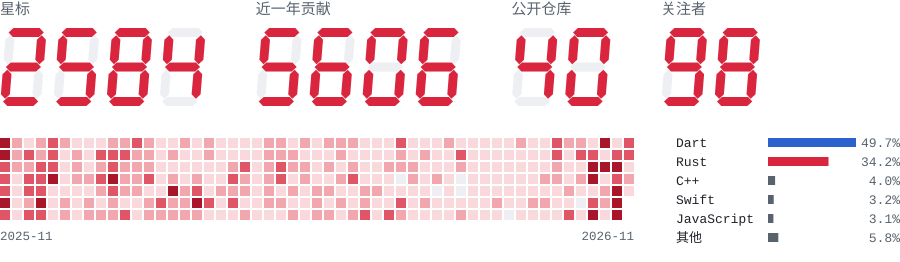

<!-- 正文直接在这里改。图片里的字在 profile.toml，改完推送后会自动重画。 -->

<a href="https://aimes-soft.com"><picture><source media="(max-width: 600px)" srcset="assets/auto/opening-phone.svg"><source media="(prefers-color-scheme: dark)" srcset="assets/dark/opening.svg"></picture></a>

## 关于我

你好，我是 MCDFsteve，一个写跨平台应用的开发者。

我最早是想在 Mac 上舒服地看番，才开始写 NipaPlay。后来项目越写越多，技术也从 Flutter 慢慢转到了 Rust。现在我把大部分时间花在 Bern 上：这是我自己的原生 UI 框架，Erika、Enji 和 RustSend 都是用它写的。

我喜欢做有趣的东西，也很在意用起来顺不顺手。平时关注 ACG、游戏、工具和自动化。我的项目大多以喜欢的作品命名，比如 Erika 来自《海猫鸣泣之时》，NipaPlay 来自《寒蝉鸣泣之时》里梨花那句「にぱー」。

## 世界线收束

这几年的项目大致是这样走过来的：以前用 Flutter 写，现在的新项目都用 Rust，不少老项目也接上了 Rust。

<picture><source media="(max-width: 600px)" srcset="assets/auto/worldline-phone.svg"><source media="(prefers-color-scheme: dark)" srcset="assets/dark/worldline.svg"></picture>

## 存档

### 主线：Rust

<a href="https://github.com/AimesSoft/Bern"><picture><source media="(max-width: 600px)" srcset="assets/auto/save-bern-phone.svg"><source media="(prefers-color-scheme: dark)" srcset="assets/dark/save-bern.svg"></picture></a>

这是我现在花时间最多的项目。界面只用 Rust 写一遍，Bern 会把它编译成 SwiftUI、WinUI 3、GTK 4、Jetpack Compose 和 Web，用的都是各平台自己的控件。桌面和手机上没有 JS 引擎，也没有内嵌浏览器，而且每个按钮都能直接被 AI 当作 MCP 工具调用。[官网](https://bern.aimes-soft.com)

<a href="https://github.com/AimesSoft/Erika"><picture><source media="(max-width: 600px)" srcset="assets/auto/save-erika-phone.svg"><source media="(prefers-color-scheme: dark)" srcset="assets/dark/save-erika.svg"></picture></a>

这是我理想中的本地播放器：打开就是一个空画框，把视频拖进去就能放，不用账号，也不用先建媒体库。想要弹幕、媒体库或追番，再打开对应的模块就行。它的目标是成为 Rust 领域的 mpv。

<a href="https://github.com/MCDFsteve/Enji"><picture><source media="(max-width: 600px)" srcset="assets/auto/save-enji-phone.svg"><source media="(prefers-color-scheme: dark)" srcset="assets/dark/save-enji.svg"></picture></a>

网易云音乐第三方客户端，Mac、Windows、Linux、iPhone、安卓都能用。小巧顺手，本地的歌也会自动配上歌词和封面。macOS 版只有 13.9 MiB。

<a href="https://github.com/AimesSoft/RustSend"><picture><source media="(max-width: 600px)" srcset="assets/auto/save-rustsend-phone.svg"><source media="(prefers-color-scheme: dark)" srcset="assets/dark/save-rustsend.svg"></picture></a>

这是一个在局域网里传文件的工具，兼容 LocalSend，从界面到传输全部用 Rust 写成。macOS 版只有 8 MiB 左右，不需要账号，也不经过云服务器。

### 支线：Flutter

<a href="https://github.com/AimesSoft/NipaPlay-Reload"><picture><source media="(max-width: 600px)" srcset="assets/auto/save-nipaplay-reload-phone.svg"><source media="(prefers-color-scheme: dark)" srcset="assets/dark/save-nipaplay-reload.svg"></picture></a>

这是我星标最多的项目，一款跨平台的本地弹幕播放器。它能自动匹配弹幕，可以挂载 Emby、Jellyfin、SMB 和 WebDAV，还能同步 Bangumi 的观看进度。[官网](https://nipaplay.aimes-soft.com)

<a href="https://github.com/AimesSoft/MisuzuMusic"><picture><source media="(max-width: 600px)" srcset="assets/auto/save-misuzu-music-phone.svg"><source media="(prefers-color-scheme: dark)" srcset="assets/dark/save-misuzu-music.svg"></picture></a>

这是一款界面仿 Apple Music 的本地音乐播放器。它会自动匹配歌词和封面，也能给日语汉字标注假名。

<a href="https://github.com/AimesSoft/SakiEngine"><picture><source media="(max-width: 600px)" srcset="assets/auto/save-sakiengine-phone.svg"><source media="(prefers-color-scheme: dark)" srcset="assets/dark/save-sakiengine.svg"></picture></a>

这是一个视觉小说和 Galgame 引擎。同一句脚本里可以写简中、繁中、英语和日语，演出可以边改边看。[官网](https://sakiengine.aimes-soft.com)

<a href="https://github.com/AimesSoft/MisaRin"><picture><source media="(max-width: 600px)" srcset="assets/auto/save-misarin-phone.svg"><source media="(prefers-color-scheme: dark)" srcset="assets/dark/save-misarin.svg"></picture></a>

这是一款绘画和像素创作软件，用 Rust 光栅化笔刷，用 WGPU 渲染画布。就算只有鼠标，也能画出带笔锋的线条。

## 技能栈

写得最多的是 Rust 和 Dart。做 Bern 的时候经常要和 Swift、Kotlin、C++ 打交道，所以 SwiftUI、WinUI 3、GTK 4、Jetpack Compose 也都写过不少。音视频和图形方面常用 FFmpeg、libass、wgpu 和 Metal。最近我还在给自己的应用接 MCP，让 AI 能直接操作它们。

## 观测

下面的红字都是真的，每天自动更新。

<picture><source media="(max-width: 600px)" srcset="assets/auto/observation-phone.svg"><source media="(prefers-color-scheme: dark)" srcset="assets/dark/observation.svg"></picture>

## 通信

想找我的话，可以来这些地方：

- 官网：[aimes-soft.com](https://aimes-soft.com)
- 项目站：[Bern](https://bern.aimes-soft.com) / [NipaPlay](https://nipaplay.aimes-soft.com) / [SakiEngine](https://sakiengine.aimes-soft.com)
- GitHub 组织：[AimesSoft](https://github.com/AimesSoft)
- 其他：[Pixiv](https://www.pixiv.net/users/41131084) / [Steam](https://steamcommunity.com/id/dfsteve)

> 让代码成为表达自我的方式。
>
> Let code be the way to express myself.
